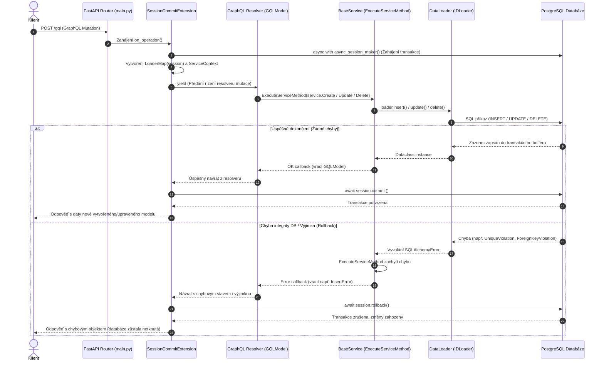

# Transakce a Rollback v architektuře projektu `gql_evolution`

Tento dokument detailně popisuje životní cyklus databázových transakcí, mechanismus **commit** a **rollback**, pořadí volání jednotlivých komponent a architektonická pravidla projektu.

---

## 1. Základní principy a architektura

V projektu je implementován vzor **Unit of Work** vázaný na životní cyklus jednotlivých GraphQL požadavků:

> [!IMPORTANT]
> **Jedna GraphQL operace = Jedna databázová session a transakce.**
> Žádná servisní třída (ani [`BaseService`](file:///Users/lukaskaplanek/Desktop/Informatika/UNOB/gql_evolution/src/ServiceDefinitions/BaseService.py)), ani samotné modely nevolají `commit()` ani `rollback()` přímo. Veškeré transakční řízení je delegováno na vrstvu infrastruktury.

### Oddělení odpovědností (Separation of Concerns)

```text
DBDefinitions (SQLAlchemy tabulky, omezení, relace)
      ▲
      │ operace nad session
Dataloaders (IDLoader - provádí insert/update/delete v rámci session)
      ▲
      │ delegování CRUD
ServiceDefinitions (BaseService - byznys logika, mapování chyb)
      ▲
      │ volání service metod
GraphTypeDefinitions (GraphQL resolvery a mutace)
      ▲
      │ obalení transakcí
SessionCommitExtension (otevření session, commit / rollback, uvolnění)
```

---

## 2. Přehled zapojených komponent

| Komponenta | Umístění v projektu | Role v transakčním cyklu |
|---|---|---|
| **`SessionCommitExtension`** | [`src/GraphTypeDefinitions/SessionCommitExtension.py`](file:///Users/lukaskaplanek/Desktop/Informatika/UNOB/gql_evolution/src/GraphTypeDefinitions/SessionCommitExtension.py) | Otevírá `AsyncSession`, předává ji do kontextu a po skončení operace provádí `commit()` nebo `rollback()`. |
| **`GraphQLContext` / `ServiceContext`** | [`src/GraphTypeDefinitions/GraphQLContext.py`](file:///Users/lukaskaplanek/Desktop/Informatika/UNOB/gql_evolution/src/GraphTypeDefinitions/GraphQLContext.py), [`src/ServiceDefinitions/ServiceContext.py`](file:///Users/lukaskaplanek/Desktop/Informatika/UNOB/gql_evolution/src/ServiceDefinitions/ServiceContext.py) | Přepravka pro aktuální session, dataloadery a registrované služby napříč resolverem. |
| **GraphQL Resolver** | např. [`PersonalDataGQLModel.py`](file:///Users/lukaskaplanek/Desktop/Informatika/UNOB/gql_evolution/src/GraphTypeDefinitions/Domain_Personalities/PersonalData/PersonalDataGQLModel.py) | Přijímá vstupní data, ověřuje oprávnění a volá servisní vrstvu přes `ExecuteServiceMethod`. |
| **`BaseService`** | [`src/ServiceDefinitions/BaseService.py`](file:///Users/lukaskaplanek/Desktop/Informatika/UNOB/gql_evolution/src/ServiceDefinitions/BaseService.py) | Zprostředkovává operace na loaderu, odchytává `SQLAlchemyError` a převádí je na typované chybové objekty. |
| **`IDLoader`** | `uoishelpers.dataloaders.IDLoader` / [`LoaderMap`](file:///Users/lukaskaplanek/Desktop/Informatika/UNOB/gql_evolution/src/Dataloaders/__init__.py) | Vykonává SQL příkazy nad otevřenou session bez provádění commitu. |

---

## 3. Sekvenční diagram průchodu požadavku

Následující diagram znázorňuje posloupnost volání od příchodu HTTP požadavku až po konečné rozhodnutí mezi `commit` a `rollback`.



---

## 4. Podrobný postup volání (Krok za krokem)

### Krok 1: Inicializace transakce
1. Požadavek dorazí na endpoint `/gql` definovaný v [main.py](file:///Users/lukaskaplanek/Desktop/Informatika/UNOB/gql_evolution/main.py#L32).
2. Spustí se metoda `on_operation()` v [SessionCommitExtension.py](file:///Users/lukaskaplanek/Desktop/Informatika/UNOB/gql_evolution/src/GraphTypeDefinitions/SessionCommitExtension.py#L76):
   ```python
   async with async_session_maker() as session:
   ```
   * Vytvoří se `session`, která zahajuje transakci v databázi.
   * `session` je injektována do `context['session']`.
   * Vytvoří se `LoaderMap(session)` a `ServiceContext`, které jsou uloženy do `context['ServiceCtx']`.
3. Zavolá se `yield`, čímž se řízení předá samotnému resolveru GraphQL schématu.

### Krok 2: Zpracování v resolveru a servise
4. Spustí se resolver příslušné mutace (např. `personal_data_insert`):
   ```python
   service = info.ServiceCtx.Services.PersonalDataService
   return await service.ExecuteServiceMethod(
       service.Create(ctx=info.ServiceCtx, entity=personal_data),
       Error=service.CreateErrorCallback(...),
       OK=PersonalDataGQLModel.from_dataclass,
   )
   ```
5. `BaseService.Create()` předá entitu do `loader.insert()`.
6. Loader odešle SQL dotaz do databáze v rámci stávající necommitnuté session.

### Krok 3: Vyhodnocení a ukončení transakce
Po dokončení resolveru pokračuje kód v `SessionCommitExtension` za řádkem `yield`:

```python
operation_type = self._get_operation_type() or 'mutation'
errors = context.get('errors', [])

if errors:
    await session.rollback()
    print('Rollback session due to error flag', flush=True)
elif operation_type == 'mutation':
    await session.commit()
    print('Commit session', flush=True)
else:
    await session.rollback()
    print('Rollback read-only operation', flush=True)
```

#### Kdy přesně nastává COMMIT:
* Operace je typu `mutation`,
* v kontextu nevznikly žádné chyby (`context['errors']` je prázdné),
* neproběhla žádná nezachycená výjimka.
* **Výsledek:** Zavolá se `await session.commit()`.

#### Kdy přesně nastává ROLLBACK:
1. **Při chybě integrity nebo validace:** `BaseService.ExecuteServiceMethod` zachytí `SQLAlchemyError` / `ServiceExceptionWithCode`. Pokud je nastaven příznak chyby nebo session selže, provede se `await session.rollback()`.
2. **Při neošetřené výjimce:** Blok `except Exception as e` v `SessionCommitExtension` zachytí jakýkoliv pád kódu, přidá systémovou chybu do kontextu, provede `await session.rollback()` a výjimku znovu vyvolá (`raise`).
3. **U čtecích dotazů (`query`):** Pro `query` se neprovádí commit, ale transakce se korektně uvolní přes `await session.rollback()`.

---

## 5. Implementované testy v projektu

| Typ testu | Soubor | Testované chování |
|---|---|---|
| **Unit test** | [`tests/graphql/test_session_commit_extension_unit.py`](file:///Users/lukaskaplanek/Desktop/Informatika/UNOB/gql_evolution/tests/graphql/test_session_commit_extension_unit.py) | Ověřuje, že úspěšná mutace provede přesně `session.commits == 1, session.rollbacks == 0`. |
| **Unit test** | [`tests/graphql/test_session_commit_extension_unit.py`](file:///Users/lukaskaplanek/Desktop/Informatika/UNOB/gql_evolution/tests/graphql/test_session_commit_extension_unit.py) | Ověřuje, že při chybě v kontextu se provede `session.commits == 0, session.rollbacks == 1`. |
| **Unit test** | [`tests/graphql/test_session_commit_extension_unit.py`](file:///Users/lukaskaplanek/Desktop/Informatika/UNOB/gql_evolution/tests/graphql/test_session_commit_extension_unit.py) | Ověřuje, že při výjimce nastane `session.rollbacks == 1` a výjimka se znovu vyvolá. |
| **Integrační test** | [`tests/graphql/test_event_gql_explicit.py`](file:///Users/lukaskaplanek/Desktop/Informatika/UNOB/gql_evolution/tests/graphql/test_event_gql_explicit.py#L232) | Testuje entitu `Event`: ověřuje odmítnutí duplicitního vložení v DB a rollback operace. |
